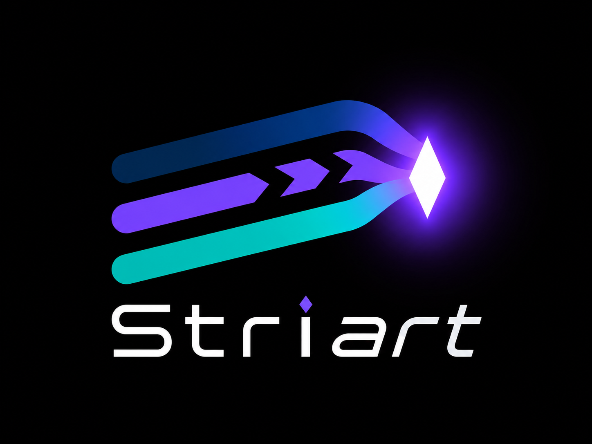

<h1 align="center">
  
</h1>

<p align="center">
  <strong>Orchestrateur Git multi-agents</strong> pour Claude Code, Aider, Cursor et tout autre agent de coding IA.<br>
  Isolation physique · Routing préventif · Fusion sémantique · Test Gate bloquant
</p>

<p align="center">
  
  
  
  
  
</p>

<p align="center">
  <a href="#pourquoi-striart--et-pas-simplement-des-worktrees-">Pourquoi Striart</a> ·
  <a href="#installation">Installation</a> ·
  <a href="#démarrage-express">Démarrage</a> ·
  <a href="#documentation">Documentation</a> ·
  <a href="#règles-dor">Règles d'or</a>
</p>

<p align="center"><em>🇬🇧 <a href="README.md">English version (default)</a> — this French README remains the content reference.</em></p>

Quand plusieurs agents IA travaillent en parallèle sur le même repo, ils se marchent dessus :
conflits Git, commits gloutons, merges sémantiquement cassés. Striart résout ça avec trois piliers :

1. **Isolation physique** — chaque agent travaille dans un vrai clone Git indépendant, sans remote (`.striart/agents/<nom>/`).
2. **Router préventif** — avant de lancer un agent, un LLM prédit les fichiers touchés et met en file d'attente les tâches en collision. C'est un filtre grossier, pas une garantie : la sécurité repose sur la fusion et le Test Gate ([mesures](docs/fr/architecture.md#ce-que-valent-le-router-et-la-fusion-sémantique--mesures-du-2026-10-26)).
3. **Fusion sémantique + Test Gate** — les commits des agents sont mergés automatiquement ; en cas de conflit, un LLM fusionne le code ; rien n'est commité tant que `npm test` (ou votre commande) ne passe pas.

Striart n'est pas un cerveau central opaque : c'est un **pacemaker Git**. L'humain voit tout, peut interrompre, corriger, valider.

### Les problèmes que Striart résout

| Sans Striart | Avec Striart |
|---|---|
| Deux agents modifient les mêmes fichiers ; le conflit se découvre au merge, une fois le travail fait. | Le **Router** prédit les fichiers touchés et met en file les tâches en collision **avant** le lancement. |
| Ramener N branches à la main, dans le bon ordre, en rebasant les agents encore actifs. | Une **chaîne de merge sérialisée** sous verrou, et, sous `striart watch`, un rebase automatique de tous les agents après chaque merge. |
| Un conflit bloque, ou pire : un merge « propre » casse le comportement. | **Fusion sémantique 3-way** par LLM, puis **Test Gate bloquant** : pas de commit sans suite verte, sinon abort + ticket humain complet. |
| Un agent qui déraille (`reset --hard`, `gc`, secrets) abîme l'état commun. | **Clones complets** sans remote : le rayon d'explosion est le clone ; secrets retirés ; chemins protégés pour ce qui configure l'agent et Striart. |
| Une session autonome qui dépense sans limite ou qui tourne sans témoin. | Budgets de **tokens** à plafonds (fail closed), verrous à battement, reprise après crash, arbitrage humain des permissions. |
| Chaque outil d'agent a sa façon de travailler. | **20 presets prêts** (Claude, Codex, Gemini, Copilot, Cursor, Aider…), pilotables en **MCP** et **ACP**, y compris depuis l'éditeur (`striart acp`). |

Le panorama des projets similaires (Claude Squad, Conductor, Nimbalyst, Weave,
Agent Client Protocol…) et **quand choisir quoi** sont dans
**[docs/fr/comparaison.md](docs/fr/comparaison.md)**.

---

## Pourquoi Striart — et pas simplement des worktrees ?

Isoler les fichiers n'est qu'une partie du problème. Un worktree (ou un clone fait à
la main) évite que deux agents écrivent au même endroit *en même temps* — tout
le reste reste à ta charge, à chaque tâche : éviter les collisions *avant*
qu'elles n'arrivent, ramener N branches dans la branche cible, arbitrer les
conflits, garantir que rien de cassé n'entre. Striart automatise précisément ce reste.

| Besoin | Worktrees à la main | Sous-agents Claude Code (worktrees intégrés) | Striart |
|---|---|---|---|
| Isolation des fichiers | ✅ | ✅ (zéro friction) | ✅ clones complets |
| Solidité face à un agent qui déraille | ⚠️ `.git/` partagé : un `reset --hard` ou un `gc` touche l'état commun | ⚠️ idem | ✅ refs/index propres, pas de remote, secrets exclus — rayon d'explosion borné au clone |
| Prévention des collisions | ❌ à ta charge | ❌ dépend du découpage du modèle | ✅ Router LLM + file d'attente + dépendances `--after` |
| Retour du travail dans la branche cible | ❌ merges manuels | ❌ à la charge de l'agent | ✅ merge auto, rebase de tous les agents après chaque merge de `striart watch`, fusion sémantique 3-way |
| Garde-fou de qualité | ❌ | ❌ | ✅ **Test Gate bloquant** — rien n'entre sans suite verte |
| Multi-fournisseurs | ❌ | ❌ Claude uniquement | ✅ 20 presets prêts (Claude, Codex, Gemini, Copilot, Cursor, Aider…) côte à côte |
| Durée de vie | la session | la session | ✅ des heures/jours, plusieurs sessions, file persistante |
| Observabilité & contrôle | ❌ | limité à la session | ✅ dashboard temps réel (lien de connexion à usage unique), relevé des tokens et coûts avec plafonds, logs persistants, semi-autonome (tu arbitres les permissions), rollback |

Le détail du raisonnement (clones vs worktrees, emboîtement avec les
sous-agents de Claude Code, symétrie MCP/ACP) est dans
**[docs/fr/architecture.md](docs/fr/architecture.md)**.

---

## Installation

Depuis les sources :

```bash
git clone https://github.com/personamanagmentlayer/striart.git
cd striart && npm install && npm run native:build && npm link   # expose la commande `striart`
cd /chemin/vers/mon-projet
striart init
```

Prérequis : Node.js 22.21+ (type stripping natif — rien à compiler côté
JavaScript), Git, **un repo Git avec au moins un commit**, et un LLM pour le
Router/Merger — Ollama en local (défaut) **ou** n'importe quelle API cloud. Striart
s'appuie sur un petit **binaire natif** (Rust) signé, vérifié avant chaque
exécution : depuis les sources, `npm run native:build` le construit (toolchain
Rust requise) ; une archive produite par `npm run pack:release` embarque les
binaires précompilés. Tout le détail : **[docs/fr/demarrage.md](docs/fr/demarrage.md)**.

---

## Démarrage express

```bash
cd mon-projet
striart init                          # crée .striart/, la config, puis diagnostique

# Onglet 1 — l'orchestrateur
striart watch                         # merge + Test Gate + rebase automatiques

# Lancer des agents (le Router vérifie les collisions avant chaque lancement)
striart run "Refactor le module d'authentification" --command "claude" --open
striart run "Ajoute la facturation Stripe" --agent billing --command "aider --model gpt-4o" --open

# ...et pour une tâche cadrée qu'on ne veut pas surveiller, Striart pilote seul :
striart run "Ajoute des tests unitaires à src/parser.js" --autonomous --profile claude

# Plusieurs agents sur UNE tâche : relecture croisée, course, équipe, pipeline
striart orchestrate review "Passe l'auth en JWT" --author claude --reviewer codex

# Suivi
striart status / queue / dashboard / usage / resolve
striart gc --dry-run                  # agents oubliés : sessions inactives (fermeture opt-in, sur autorisation de l'utilisateur)
```

Striart se pilote par **trois plans distincts** : `striart mcp` (l'agent pilote
Striart, borné à son clone), `striart api` et `striart dashboard` (l'humain
pilote Striart : Control Protocol, lien de connexion à usage unique) et
`striart acp` (Striart comme agent ACP dans Zed, JetBrains, Neovim, Emacs :
une session d'éditeur = un clone isolé + un merge sous Test Gate).

Codes de sortie scriptables (0 succès, 1 échec, 2 usage, 3 refus d'une
garde), `--json` sur toutes les commandes à résultat, aide en français ou en
anglais (`STRIART_LANG`), complétion bash/zsh/fish/PowerShell
(`striart completion <shell>`) — voir [Commandes](docs/fr/commandes.md#le-contrat-de-la-cli).

---

## Documentation

La documentation complète vit dans **[docs/fr/](docs/fr/README.md)**
(🇬🇧 [docs/en/](docs/en/README.md)) :

| Page | Contenu |
|---|---|
| [Démarrage](docs/fr/demarrage.md) | Prérequis, installation, `striart init`, guide « 3 agents en parallèle ». |
| [Architecture](docs/fr/architecture.md) | Clones vs worktrees, chaîne sérialisée, flow d'un commit, les 6 statuts de sync, verrous, fichiers d'état, livraison hors verrou, couche réseau, les trois plans, composants natifs, ce que vaut le Router, GC d'inactivité, observabilité. |
| [Commandes](docs/fr/commandes.md) | Le contrat de la CLI (codes de sortie, `--json`, langue, complétion) et les 31 commandes : options, garde-fous, codes de refus. |
| [Configuration](docs/fr/configuration.md) | Référence complète de `striart.config.mjs` : défauts et bornes, providers LLM, tokens, profils, fiabilité du Router, chemins protégés, terminal, MCP, orchestration, filet de chevauchement, GC d'inactivité, livraison, environnement du Test Gate, réseau d'entreprise. |
| [Branches et pipeline](docs/fr/branches.md) | `targetBranch` sur n'importe quelle branche (`dev`, `master`…), pipeline staging → main. |
| [Modes d'exécution](docs/fr/modes-execution.md) | Supervisé, autonome, ACP, semi-autonome, `striart acp`, modes d'orchestration (`review`, `race`, `team`, `pipeline`). |
| [Plans](docs/fr/plans.md) | Tâches-as-code : le graphe de tâches YAML versionné (v1 et v2). |
| [Serveur MCP](docs/fr/mcp.md) | Piloter Striart depuis Claude Code, Cursor ou tout hôte MCP (borné au clone appelant). |
| [Intégrations](docs/fr/integrations/README.md) | Visual Studio, VS Code, Cursor, Xcode, Theia, Devin Desktop, JetBrains, Zed, Neovim, Emacs, Warp : MCP et ACP ; extension VS Code livrée mais non publiée. |
| [Striart face aux alternatives](docs/fr/comparaison.md) | Problèmes résolus, projets similaires et quand choisir quoi (sources citées). |
| [Projets volumineux](docs/fr/projets-volumineux.md) | Maîtriser le coût disque des clones. |
| [Dépannage](docs/fr/depannage.md) | `striart doctor`, tous les codes d'erreur, tickets, `rollback`, `reconcile`, verrous, réseau d'entreprise. |

---

## Règles d'or

1. **Jamais de push depuis un agent.** Les clones sont des îlots sans remote ; seul l'orchestrateur pousse.
2. **Jamais de commit sans Test Gate vert.** Même si le LLM de fusion est « sûr de lui ».
3. **Jamais de suppression d'un clone pendant qu'un agent travaille.** `striart clean` refuse à deux niveaux : `IN_USE` (heuristique, `--force` possible en connaissance de cause) et `SESSION_LIVE` (fait vérifié — session autonome ou terminal `--open` vivant —, que **`--force` ne peut pas écraser**).
4. **Fallback humain obligatoire.** 3 fusions sémantiques échouées d'affilée → mode manuel jusqu'à `striart resolve --unlock`, avec un ticket complet par échec dans `.striart/conflicts/`.

---

## Développement

**3386 tests** (2226 unitaires + 1154 d'intégration sur de vrais repos Git, plus
6 tests de fumée du paquet construit — projet `pack` —, comptés par
`npx vitest list` le 2026-10-27 ; le badge les compte, il ne certifie pas un
passage), plus 87 tests de bout en bout du dashboard (`npm run test:e2e`, hors
`npm test`),
typecheck `tsc` sur tout le code (TS natif + JS annoté JSDoc), zéro étape de
build en développement — `bin` pointe sur la source. Seul le paquet construit par `npm run pack:release`
contient du JS émis (`npm run pack:release` : Node refuse le type stripping
sous `node_modules`).

```bash
npm install
npm run native:build     # binaire natif (toolchain Rust) — requis depuis les sources
npm run test:unit        # 2226 tests — la boucle de dev
npm run test:integration # 1154 tests — vrais repos Git temporaires
npm run test:pack        # paquet construit : pack → npm install → binaire installé (réseau)
npm test                 # unit + intégration (hors réseau)
npm run lint             # ESLint (correctness) + Prettier --check
npm run test:ci          # typecheck + unit + intégration avec coverage, puis paquet
npm run test:e2e         # bout en bout du dashboard (Playwright + axe) — hors `npm test`, navigateur requis
```

Voir [CONTRIBUTING.md](CONTRIBUTING.md) et [SECURITY.md](SECURITY.md).

Licence MIT.
