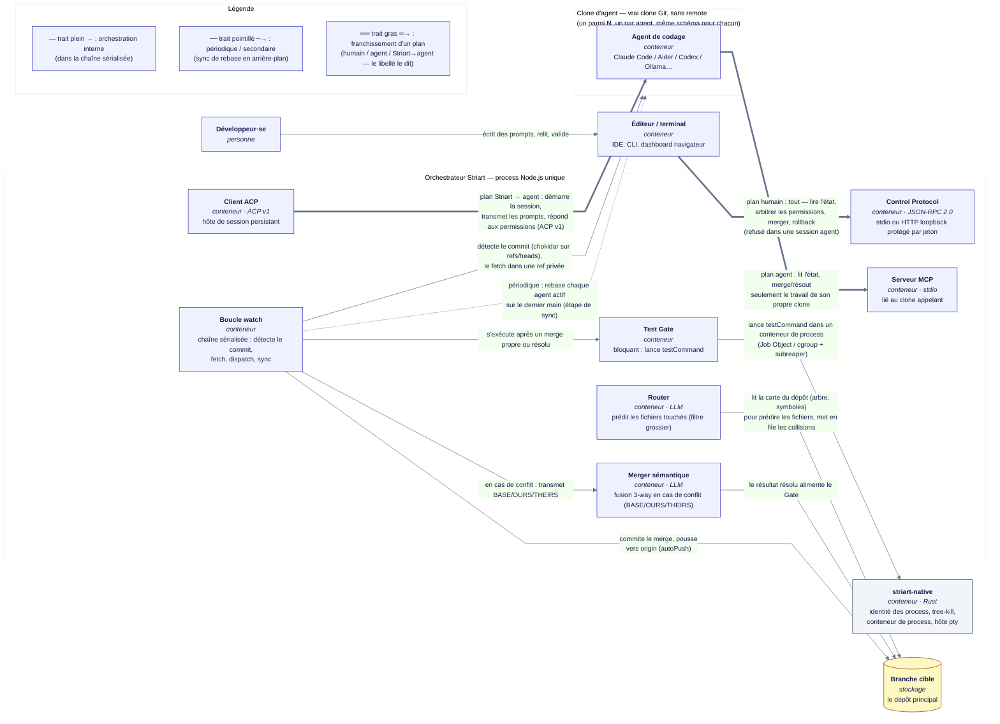

# Architecture

> [Documentation](README.md) · Architecture

## Vue d'ensemble

Une vue au niveau conteneur de qui parle à qui : les trois plans (Control
Protocol humain, MCP agent, ACP Striart→agent), la chaîne de fusion
sérialisée (Router → Merger → Test Gate), et le binaire natif. Le
[flow d'un commit agent](#flow-dun-commit-agent) plus bas donne la séquence
pas à pas ; ce schéma donne l'image statique dans laquelle elle s'exécute.



Ce que ça montre, en une ligne chacun : le·la développeur·se pilote tout via
le **Control Protocol** ; chaque agent de codage n'atteint jamais que l'état
de son propre clone via le **serveur MCP** ; Striart lui-même démarre et
pilote chaque agent via son **client ACP** ; la **boucle watch** est la
chaîne sérialisée qui fetch le commit d'un agent, transmet les conflits au
**Merger sémantique**, lance le **Test Gate** (via le conteneur de process de
**striart-native**) avant de commiter et pousser ; le **Router** ne fait que
lire la branche cible pour prédire les fichiers à l'avance, il ne parle
jamais directement à un clone.

## Les trois piliers

Quand plusieurs agents IA travaillent en parallèle sur le même repo, ils se
marchent dessus : conflits Git, commits gloutons, merges sémantiquement
cassés. Striart résout ça avec trois piliers :

1. **Isolation physique** — chaque agent travaille dans un vrai clone Git
   indépendant, sans remote (`.striart/agents/<nom>/`).
2. **Router préventif** — avant de lancer un agent, un LLM prédit les fichiers
   touchés et met en file d'attente les tâches en collision. C'est un **filtre
   grossier, pas une garantie** : voir
   [ce que valent le Router et la fusion](#ce-que-valent-le-router-et-la-fusion-sémantique--mesures-du-2026-10-26).
3. **Fusion sémantique + Test Gate** — les commits des agents sont mergés
   automatiquement ; en cas de conflit, un LLM fusionne le code ; rien n'est
   commité tant que `npm test` (ou votre commande) ne passe pas.

Striart n'est pas un cerveau central opaque : c'est un **pacemaker Git**.
L'humain voit tout, peut interrompre, corriger, valider.

## Pourquoi des clones — et pas des worktrees ?

Isoler les fichiers n'est qu'une partie du problème. Un worktree (ou un clone fait à
la main) évite que deux agents écrivent au même endroit *en même temps* — tout
le reste reste à ta charge, à chaque tâche : éviter les collisions *avant*
qu'elles n'arrivent, ramener N branches dans la branche cible, arbitrer les
conflits, garantir que rien de cassé n'entre. Striart automatise précisément
ce reste.

| Besoin | Worktrees à la main | Sous-agents Claude Code (worktrees intégrés) | Striart |
|---|---|---|---|
| Isolation des fichiers | ✅ | ✅ (zéro friction) | ✅ clones complets |
| Solidité face à un agent qui déraille | ⚠️ `.git/` partagé : un `reset --hard` ou un `gc` touche l'état commun | ⚠️ idem | ✅ refs/index propres, pas de remote, secrets exclus — rayon d'explosion borné au clone |
| Prévention des collisions | ❌ à ta charge | ❌ dépend du découpage du modèle | ✅ Router LLM + file d'attente + dépendances `--after` |
| Retour du travail dans la branche cible | ❌ merges manuels | ❌ à la charge de l'agent | ✅ merge auto, rebase de tous les agents après chaque merge, fusion sémantique 3-way |
| Garde-fou de qualité | ❌ | ❌ | ✅ **Test Gate bloquant** — rien n'entre sans suite verte |
| Multi-fournisseurs | ❌ | ❌ Claude uniquement | ✅ Claude + Aider + Codex + Ollama… côte à côte |
| Durée de vie | la session | la session | ✅ des heures/jours, plusieurs sessions, file persistante |
| Observabilité & contrôle | ❌ | limité à la session | ✅ dashboard temps réel, logs persistants, semi-autonome (tu arbitres les permissions), rollback |

**Clones, pas worktrees — un choix de sûreté.** Les worktrees Git partagent
le `.git/` principal : parfait pour un humain discipliné, dangereux pour un
agent non supervisé qui lance ses propres commandes git. Striart donne à
chaque agent un vrai clone — et en neutralise le coût classique : clone par
chemin local, git **hardlinke nativement les objets** (immuables, donc sûrs
même si le principal fait un `gc`), aucune recopie des objets (coût non mesuré ici), l'historique
ne coûte qu'une fois. L'isolation porte sur tout ce qui est **mutable** :
worktree en vraie copie, refs et index propres.

Sont volontairement **interdits** : les alternates (couplage vivant avec le
`gc` du principal) et les hardlinks/symlinks sur le worktree ou
`node_modules` (corruption par écriture in-place, contamination des caches).

**Emboîtement, pas duel.** Striart est agnostique de l'agent : Claude Code
*est* l'un de ses agents. Le schéma naturel — Striart lui donne un clone
isolé (supervisé, autonome, ou protocolaire via ACP), et *à l'intérieur*,
Claude Code reste libre d'utiliser ses propres worktrees pour ses
sous-agents : les deux mécanismes se composent. Via le serveur MCP, l'agent
peut même piloter Striart au lieu de le contourner. En une phrase :
**worktrees = parallélisme intra-session à friction nulle ; Striart =
orchestration inter-agents avec intégration continue et gate de qualité.**

## Les clones n'ont pas de remote `origin`

L'orchestrateur est le seul à pousser. Les agents travaillent dans des clones
orphelins, sur une branche de tâche `striart/<agent>/task-<uuid>`.
L'orchestrateur fait `git fetch ../agent-a/` puis merge dans le repo
principal. Les secrets **trackés** (`secretPatterns` en config : `.env`,
`*.pem`…) sont retirés du worktree des clones via sparse-checkout ; les
untracked ne sont jamais clonés par git. Les objets `.git/`, eux, sont
hardlinkés en entier (voir plus haut) : un secret **historique** — supprimé
depuis, absent du worktree et du tracké actuel — reste lisible via `git show
<sha>:<fichier>`. `createAgent`/`reuseAgent` scannent tout l'historique contre
`secretPatterns` avant de cloner et refusent (`HISTORICAL_SECRETS_FOUND`,
fail closed, aucun clone créé) si un chemin historique matche ;
`--allow-historical-secrets` (`striart start`, `striart run`, `striart run
--autonomous`) passe outre en connaissance de cause — un consentement
distinct de `--force`, qui ne vaut que pour la perte de travail.

Chaque commande git qui vise un clone passe par `cloneGit` : elle est
**bornée au clone** (`GIT_CEILING_DIRECTORIES` — un clone au `.git` manquant
ou corrompu échoue franchement au lieu de remonter jusqu'au repo principal
qui le contient) et ne reçoit **aucune** variable `GIT_*` héritée
(`GIT_DIR`, `GIT_WORK_TREE`, `GIT_INDEX_FILE`… posées par un hook git ou un
IDE désigneraient un autre dépôt que le clone), ni `EDITOR`, `VISUAL`,
`PAGER`, `PREFIX` ou `SSH_ASKPASS`.

## Le layout `.striart/`

```text
mon-projet/
├── .striart/                  # généré par striart init, gitignoré
│   ├── agents/
│   │   ├── auth/             # vrai clone Git indépendant, sans remote
│   │   └── billing/          # branche striart/<agent>/task-<uuid>
│   ├── agents.json           # registre : branche, outil, prédictions, base de merge
│   ├── queue.json            # tâches en attente (collisions du Router)
│   ├── locks.json            # verrous optimistes (fichier → agent)
│   ├── state.json            # compteur d'échecs sémantiques / mode manuel
│   ├── main.lock             # verrou principal inter-processus (transitoire, bat toutes les 5 s)
│   ├── lock-queue/           # file équitable du verrou principal (+ break.lock, verrou de cassure)
│   ├── state.lock            # verrou d'état court (+ state.lock.break, transitoires)
│   ├── merge-state-changed.json  # marqueur « merge ouvert qui n'est pas à Striart » (transitoire)
│   ├── main-session.json     # session déclarée sur le repo principal (--on-main, lock --start)
│   ├── idle/                 # GC d'inactivité : state.json (avertissements), beats/<agent>.beat (battement de sortie d'une session autonome), close/<agent>.json (demande d'arrêt propre)
│   ├── removing/<agent>.json # suppression de clone entamée, à terminer (réconciliation)
│   ├── watch.pid / dashboard.pid  # daemons en arrière-plan
│   ├── <nom>.stop / <nom>.pid.lock  # demande d'arrêt d'un daemon / verrou du PID file (transitoires)
│   ├── completion-profiles.json  # noms de profils publiés par `striart profiles` pour la complétion
│   ├── memory.md             # Memory Layer (si memoryLayer: true)
│   ├── conflicts/<ticket>/   # base/ours/theirs + llm-attempt + test-output.log
│   ├── permissions/          # demandes d'arbitrage (permissions, questions de l'agent) du mode semi-autonome
│   ├── reviews/              # relectures humaines des tâches `review`
│   ├── collab/<groupe>.json  # messages du canal de collaboration
│   ├── orchestration/        # état des plans (runs/) et des groupes orchestrés (groups/)
│   ├── usage/                # registre des tokens AAAA-MM-JJ.ndjson + cache/ des résultats LLM
│   ├── instructions/<agent>.json  # manifeste des fichiers de consignes injectés dans un clone
│   ├── control/              # jeton du dashboard (dashboard-<port>.json, lisible par l'utilisateur seul)
│   ├── pty/<agent>/          # hôte de pty natif d'un agent --open (host.pid, host.stop, canal d'attache)
│   ├── acp/<agent>/          # hôte de session ACP persistant (host.pid, host.stop, bus.token, canal local)
│   ├── acp-agents/<id>/<version>/  # binaire ACP téléchargé (acpRegistry.allowBinaryDownload)
│   └── logs/                 # watch.log, dashboard.log, watch-ui.log, pty-<agent>.log, acp-host-<agent>.log, session-*.log
└── striart.config.mjs
```

Tout `.striart/`, hors `agents/` et `removing/` (arbres de travail, jamais
parcourus), est **réservé à l'utilisateur** : dossiers `0700`, fichiers `0600`,
ou ACL protégée sous Windows (`privateStateDir`, voir
[Configuration](configuration.md#données-locales--privatestatedir)).

## La chaîne sérialisée

**Un seul processus orchestre tout** : `striart watch` détecte les commits de
tous les agents (chokidar sur `.git/refs/heads/` de chaque clone — refs
stables uniquement, dédupliquées par SHA) et traite chaque événement dans une
**chaîne sérialisée** (une chaîne de promesses fait office de verrou global et
de file FIFO). Un seul merge à la fois peut toucher le repo principal — toute
la classe de bugs « que se passe-t-il si C merge pendant que B rebase » est
éliminée structurellement, sans verrou explicite.

## Flow d'un commit agent

```text
Commit détecté sur l'agent A (chokidar sur .git/refs/heads/)
  → filtres : awaitWriteFinish (ref stable) + déduplication par SHA
  → enfilé dans la chaîne sérialisée
┌─────────────────────────────────────────────────────────────────────┐
│  ÉTAPE 0 : rebase préalable de A sur targetBranch (autoRebase)      │
│    worktree occupé → stash -u → rebase → stash pop, UNIQUEMENT si   │
│    les fichiers en cours sont disjoints des commits entrants        │
│    (vérifié par diff, pas supposé) ; sinon rebase reporté           │
│    conflit de rebase → annulé, le merge classique prend le relais   │
│                                                                     │
│  ÉTAPE 1 : fetch du commit de l'agent dans une ref PRIVÉE           │
│    (refs/striart/incoming/<agent>), puis                            │
│    • déjà contenu dans la cible → UP_TO_DATE (rien à merger)       │
│    • chemin protégé changé par l'agent → refus + ticket → FIN       │
│    git merge <sha exact> --no-commit --no-ff                        │
│    ├─ propre  → continue                                            │
│    └─ conflit → classé : binaire, lockfile, suppression/modification,│
│        submodule, trop gros → ticket humain direct ; texte →        │
│        fusion sémantique (LLM, BASE/OURS/THEIRS, par régions si     │
│        gros fichier) — échec → abort + ticket humain → FIN          │
│        (3 échecs d'affilée → mode manuel jusqu'à resolve --unlock)  │
│                                                                     │
│  ÉTAPE 2 : Test Gate (testCommand, timeout testTimeoutMs), dans le  │
│    conteneur de process natif (orphelin vivant → rouge)             │
│    ├─ vert  → continue                                              │
│    └─ rouge → merge --abort + ticket humain → FIN                   │
│                                                                     │
│  ÉTAPE 3 : contrôle avant commit (verrou toujours tenu ? HEAD,      │
│    MERGE_HEAD et index inchangés ?) — sinon LOCK_LOST /             │
│    MERGE_STATE_CHANGED, rien n'est commité — puis commit de merge   │
│    (hooks de la cible, sous commitTimeoutMs, jamais contournés) ;   │
│    verrou libéré → livraison vers origin si autoPush                │
│                                                                     │
│  ÉTAPE 4 : syncAllAgents (sauf A)                                   │
│    chaque agent B, C... est rebasé immédiatement sur le nouveau     │
│    main — B code toujours contre le code le plus récent             │
│    (mêmes garde-fous stash/disjonction qu'à l'étape 0)              │
└─────────────────────────────────────────────────────────────────────┘
  → maillon suivant de la chaîne (commit arrivé pendant le traitement)
```

En parallèle, un **fetch silencieux** périodique (`fetchIntervalMs`, 20 s)
mesure le retard de chaque agent sans jamais toucher leur working tree —
pure visibilité (logs, dashboard) ; la resynchronisation effective se fait
aux étapes 0 et 4.

### La fusion sémantique 3-way

Quand Git ne peut pas fusionner automatiquement, Striart extrait les trois
versions de chaque fichier en conflit :

- `git show :1:fichier` → version **BASE** (ancêtre commun) ;
- `git show :2:fichier` → version **OURS** (branche cible) ;
- `git show :3:fichier` → version **THEIRS** (branche agent).

Le Merger envoie les trois au LLM avec un prompt adapté au langage du
fichier, valide la sortie, puis la soumet au Test Gate. La sortie d'un LLM
est du **contenu non fiable** : elle n'entre jamais sans que le gate soit
vert (voir [SECURITY.md](../../SECURITY.md)).

### Ce que valent le Router et la fusion sémantique — mesures du 2026-10-26

Le Router est un **filtre grossier, pas une garantie** (décision n°4 de
l'architecture) : il réduit le bruit ; la fusion sémantique et surtout le Test
Gate font le reste. Deux bancs réels, opt-in et hors `npm test`, chiffrent cette
position : `npm run bench:router` et `npm run bench:merger`. Chaque cas fait un
**vrai appel à un fournisseur cloud** — les clés `ANTHROPIC_API_KEY`,
`OPENAI_API_KEY` et `GROQ_API_KEY` sont lues dans le `.env` de la racine (parsé,
jamais exécuté ; seules ces trois clés sont retenues, jamais affichées). Modèles
par défaut : `claude-haiku-5-5`, `gpt-5.4-mini` et `openai/gpt-oss-120b` (Groq).

- **Banc Router** (protocole reproductible, sans jugement humain). *Corpus*
  versionné (`scripts/data/router-bench-tasks.json`) : **94 commits réels** de
  l'historique de ce dépôt, répartis une fois pour toutes par l'empreinte de leur
  SHA en un jeu de **réglage** (60) et un jeu de **test** (34) tenu à l'écart —
  on règle sur le premier, on rapporte sur le second. La *tâche* n'est pas le
  message du commit (écrit après le travail et optimiste, il citait souvent les
  fichiers) mais une **demande naturelle et vague**, générée une fois par un LLM à
  partir du diff dont les chemins sont masqués, avec interdiction de citer chemin,
  fichier ou symbole (une validation déterministe rejette et régénère). L'*arbre*
  soumis est le `git ls-tree` du commit parent, la *vérité* l'ensemble des fichiers
  que ce commit a modifiés (verrous écartés). Il mesure précision et rappel (code
  et total), couverture complète, **détection des chevauchements** sur toutes les
  paires de tâches (vus / manqués ; alertes inutiles), jetons et latence, avec des
  **intervalles de confiance à 95 % par bootstrap**. Les requêtes LLM sont mises en
  cache sur disque (hors dépôt) : changer une variante purement déterministe ne
  repaie rien. Variantes : `legacy`, `balanced`, `recall` et des ablations
  (`scripts/data/router-bench-variants.json`).
- **Banc Merger** : 8 cas d'or, conflits textuels (BASE / OURS / THEIRS) dont les
  deux côtés restent **compatibles en intention**, chacun avec une **vérification
  exécutable** — le fichier fusionné est importé et son comportement contrôlé :
  une fusion « qui a l'air juste » mais fausse échoue. Plusieurs essais par cas
  (`--repeat`).
- **Banc du cycle de merge** (`npm run bench:merge`, sans réseau) : voir
  [Observabilité](#observabilité--durées-par-phase-contention-du-verrou-performance).

**Router — relevé du 2026-10-26** (jeu de test, 34 tâches, `claude-haiku-5-5` ;
IC 95 % entre crochets ; relevé du mainteneur, **non rejoué par la passe de
documentation et antérieur aux dernières retouches des réglages**). Le tableau
complet, avec `gpt-5.4-mini`, est dans
[Configuration](configuration.md#tokensrouter--la-fiabilité-du-router).

| Préréglage | Rappel (fichiers de code) | Chevauchements de code détectés | Alertes inutiles | Tâches sérialisées |
|---|---|---|---|---|
| `legacy` (comportement d'avant le lot) | 30 % [21–39] | 39 % [23–55] | 8 % [2–18] | 0 % |
| `balanced` (défaut) | 51 % [43–60] | 78 % [62–90] | 33 % [14–56] | 9 % |
| `recall` | 72 % [60–84] | 100 % [97–100] | 64 % [46–83] | 29 % |

Merger — 8 cas × 3 essais, relevé du 2026-10-26 (à citer **tel quel**, jamais comme
une promesse) : `claude-haiku-5-5` **24/24** fusions vérifiées, `gpt-5.4-mini`
**23/24**. Aucun chiffre n'est consigné pour `openai/gpt-oss-120b`.
L'ancien relevé du Router (message de commit comme tâche, 24 commits :
`claude-haiku-5-5` précision ~66 %, rappel ~48 %, chevauchements détectés ~58 %)
relevait d'un protocole abandonné, plus flatteur — un plafond de rappel — ; il est
remplacé par le relevé ci-dessus.

Lecture honnête :

- Avec le préréglage par défaut, **environ la moitié** des fichiers de code
  réellement touchés n'est pas prédite et environ **un chevauchement de code sur
  cinq** n'est pas vu : le Router ne prévient pas tous les conflits, et rien dans
  Striart ne le présente comme tel. Le préréglage `recall` voit presque tout,
  mais en sérialisant une tâche sur trois à une sur deux (une tâche sérialisée
  entre en collision avec tous les agents actifs, donc « détecte » tout par
  construction) — c'est un compromis, pas un gain.
- Environ **26 % des fichiers touchés sont invisibles à tout signal** (ni lexical,
  ni structurel : couplage sémantique sans trace dans les noms, les imports ni
  l'historique) d'après la mesure du mainteneur citée en tête de `src/overlap.ts`
  (non rejouée par la passe de documentation) : aucune prédiction du Router, avec
  ou sans expansion, ne les atteint. C'est pourquoi existe le filet à l'exécution
  ([`overlap`](configuration.md#overlap--le-filet-de-chevauchement-à-lexécution)),
  qui lit les fichiers *réellement* modifiés au lieu de les prédire.
- Le cas « renommage contre nouvel appelant » : git fusionne **sans conflit** un
  résultat **faux** (l'appel ajouté par l'agent utilise l'ancien nom). Le Merger
  n'est même pas invoqué — **seul le Test Gate le rattrape**, et seulement si la
  suite exerce ce code. La sécurité de Striart repose sur la fusion et le Test
  Gate, jamais sur le Router ; la qualité de `testCommand` est portante.
- Limites : 8 cas synthétiques pour le Merger ; 94 commits d'un seul dépôt
  (JavaScript et TypeScript) pour le Router, des tâches générées par un seul
  modèle (biais possible), des modèles et une date précis, des sorties non
  déterministes, des intervalles larges sur 34 tâches. Les bancs Router envoient
  des données du dépôt courant au fournisseur : l'arbre des fichiers, la carte des
  candidats (symboles et première ligne de documentation) et les demandes ; la
  **génération du corpus** (`scripts/bench-router-corpus.ts`) envoie les **diffs**
  des commits, chemins masqués (voir [SECURITY.md](../../SECURITY.md)). Ne pas les
  lancer sur un dépôt confidentiel.

## Les 6 statuts de la synchronisation

| Statut | Quand | Action humaine |
|---|---|---|
| `REBASED` (+ `stashed`) | Rebase propre — stash éventuel restauré | Aucune |
| `UP_TO_DATE` | L'agent n'a aucun commit de retard | Aucune |
| `SKIPPED_DIRTY` (+ `overlap`) | Travail en cours chevauchant les commits entrants, ou `autoStash: false` | Aucune immédiate — webhook envoyé si overlap, résolution au prochain commit |
| `REBASE_CONFLICT` (+ `stashKept`) | Les commits de l'agent conflictent avec la branche cible (la disjonction ne couvre que le non-commité) | Aucune — la fusion sémantique prend le relais au merge |
| `STASH_CONFLICT` | Stash pop en conflit (théoriquement impossible, disjonction vérifiée) | Intervention — travail en sécurité dans le stash du clone |
| `SKIPPED_SESSION` (+ `pid`) | Une session autonome tourne dans le clone — il est intouchable tant que son PID vit | Aucune — le rebase est **ajourné**, pas annulé : la fin de cycle rebase de toute façon |

`SKIPPED_SESSION` est décidé en tête de `syncAgentWithMain`, donc pour le
sync unitaire comme pour le lot : le clone est écarté **avant** qu'on tente
quoi que ce soit dessus. Les garde-fous habituels (worktree sale,
fichiers qui se recoupent) supposent un humain capable de voir ses fichiers
bouger et de réagir ; une session autonome n'a personne pour réagir, et elle
lance ses propres commandes git. Un PID resté au registre après un crash est
neutralisé par le contrôle de vitalité — un clone ne se gèle donc jamais
définitivement.

Le check de disjonction est volontairement conservateur : les renommages
comptent pour leurs **deux** chemins (ancien et nouveau, `--no-renames` côté
commits entrants, chemins `from` inclus côté worktree) — au pire un rebase
reporté inutilement, jamais un faux « safe ».

## Verrou inter-processus

La chaîne sérialisée protège *dans* le processus `watch`. Entre processus
(un `striart merge` manuel pendant que `watch` tourne, deux CLI, un serveur
MCP, un dashboard…), toute opération mutante (`run`, `merge`, `sync`, `stop`,
`promote`, `resolve --apply`, `lock --start`, retry de la file) passe par le
**verrou principal** `.striart/main.lock` (`src/lock.js`), en trois couches :

1. **Réentrance par contexte asynchrone** (`AsyncLocalStorage`). Un
   `withMainLock` appelé *depuis* la section critique d'un autre — directement
   ou par une chaîne d'`await` (stop → retry de la file, merge → sync) — la
   traverse sans rien reprendre. Un appel venu d'un *autre* contexte du même
   process (requête MCP parallèle, tâche de fond du dashboard) n'hérite de rien
   et attend son tour : l'ancien compteur global laissait deux sections
   critiques de premier niveau s'exécuter en même temps dans un même process
   (défaut prouvé par l'audit de fiabilité du 2026-10-24). Un travail *lancé
   sans être attendu* depuis une section critique hérite du contexte ; ceux qui
   touchent au principal passent par `runOutsideMainLock`.
2. **File FIFO en mémoire** par dépôt : un seul contexte du process prend part
   à la course inter-process à la fois.
3. **Exclusion inter-process** par création exclusive (`wx`, arbitrée par le
   noyau), précédée d'une **file équitable** sur disque
   (`.striart/lock-queue/`, un ticket numéroté par process en attente, servi
   par numéro croissant — plus de famine par sondage désordonné).

**Tenue par battement.** Le détenteur rafraîchit le verrou toutes les 5 s
(`mtime` + `heartbeatAt`). Un jeton aléatoire est écrit dans le fichier et
relu avant toute suppression : la libération, la sortie du process et la
cassure ne retirent jamais le verrou d'un autre. Un verrou présent n'est
cassé que sur **preuve** que son détenteur n'existe plus : process mort ; PID
réattribué à un autre programme (identité relue auprès de l'OS, heure de
création comprise) ; ancien format (sans battement) de plus de 30 min ;
contenu invalide *et* ancien. Un fichier *illisible* (droits, partage
Windows) n'est jamais cassé. Un détenteur **vivant** dont le battement est
figé (process gelé) n'est **pas** cassé par défaut — le casser laisserait
deux process dans la section critique à son dégel : l'attente se termine en
`LOCK_TIMEOUT` (`HOLDER_FROZEN`) avec le PID à arrêter ;
`lock.breakFrozenHolderAfterMs` relâche cette protection (journalisé,
affiché par `doctor`). L'attente par défaut est de 2 min.

**Cassures sérialisées.** Toute suppression d'un fichier d'autrui (verrou
périmé, ticket d'attente orphelin) se fait sous un verrou de cassure
(`lock-queue/break.lock`, création exclusive), en relisant le fichier et en
comparant contenu **et** date à ceux jugés : deux casseurs simultanés ne
peuvent plus supprimer l'un le verrou neuf de l'autre. (Alternative écartée :
renommer vers une pierre tombale puis remettre en place — la remise en place
n'est pas atomique face à un troisième process qui a déjà recréé le verrou :
deux détenteurs.) La reprise d'un verrou de cassure lui-même périmé passe par
un marqueur à création exclusive (`*.break.reclaim`). Cette brique
(`src/break-lock.ts`) est partagée avec le verrou d'état.

**Contrôle avant l'irréversible.** `assertMainLockHeld` permet à une
opération longue de vérifier, juste avant un effet irréversible (commit,
écriture dans le principal), qu'elle tient toujours le verrou (`LOCK_LOST`
sinon), et le merge revérifie `HEAD`, `MERGE_HEAD` et l'index
(`MERGE_STATE_CHANGED`). Si l'opération constate qu'un merge ouvert n'est pas
le sien, elle le consigne dans `.striart/merge-state-changed.json`, lié au
`MERGE_HEAD` en cause : toute opération refuse alors (`MERGE_RECOVERY_BLOCKED`)
au lieu d'annuler le travail d'un tiers.

À chaque acquisition — sauf session principale déclarée vivante, voir
ci-dessous —, un éventuel merge abandonné par un crash précédent
(`MERGE_HEAD` orphelin) est annulé proprement. `resolve --apply` (résolution
humaine d'un ticket de conflit) tourne entièrement sous ce verrou, Test Gate
inclus — c'est le chemin qui manquait pour qu'une résolution manuelle ne
puisse plus entrer en collision avec un merge automatique concurrent (un
incident réel : un `git merge` fait à la main hors du cadre de Striart pendant
qu'un `striart watch` tournait). Un `signal` d'annulation (MCP, dashboard,
Ctrl+C) n'annule que l'**attente** du verrou (`LOCK_WAIT_CANCELLED`) : une
section critique commencée n'est jamais interrompue.

**Dette connue (roadmap, chantier « performance et fiabilité sous charge »)** :
le verrou principal est encore tenu pendant le Test Gate et les appels LLM
d'un merge (hors verrou depuis : le push vers `origin`, voir la section
suivante ; le commit de merge reste sous verrou mais borné par
`commitTimeoutMs`) ; le clone d'intégration (décision D1 : merge, fusion LLM et Test
Gate hors verrou, le verrou ne couvrant que le fast-forward final) est
**décidé mais pas livré** — voir la décision n°3 du `CLAUDE.md` du dossier `.claude` et la
section « Performance et fiabilité sous charge continue » de la roadmap.

## Livraison vers `origin` : hors du verrou

Le push d'un merge vert n'est plus fait dans la section critique : un hook
`pre-push` d'entreprise, une authentification ou un réseau lent gelaient tout
l'orchestrateur pendant la durée du push. Les effets d'une opération — événements
(webhooks), mise à jour de la Memory Layer, **livraison** — sont désormais
*différés* : ils partent **après la libération du verrou principal**
(`runWithDeferredEffects`, `src/orchestrator.js`). La livraison
(`src/delivery.ts`) pousse le **SHA exact** qui a passé le Test Gate
(`<sha>:refs/heads/<branche>`, jamais `HEAD`, jamais `--force`), avec :

- un **délai dur** (`pushTimeoutMs`) et la mort de l'**arbre** de process au
  délai (le hook est un petit-fils de git) — ce que simple-git ne sait pas faire ;
- aucune **invite** possible (`GIT_TERMINAL_PROMPT=0`, `GCM_INTERACTIVE=never`,
  stdin fermé, aucune variable `GIT_*` héritée) ;
- la **sortie** du hook conservée, bornée à sa fin (16 Kio), les jetons d'URL de
  remote caviardés ;
- une **chaîne par dépôt** dans le process (deux merges successifs poussent dans
  l'ordre) et, entre process, la reconnaissance d'un SHA déjà publié par un
  push concurrent (`alreadyDelivered`) ;
- une garde : le SHA doit encore être dans la branche locale au moment du push
  (`PUSH_SUPERSEDED` sinon — un rollback est passé), et `rollback` attend les
  livraisons en vol de son process avant de décider si le merge est « publié ».

Le **commit de merge** reste sous le verrou (il conclut un merge ouvert dans le
principal) mais est lui aussi borné : `commitTimeoutMs`, arbre tué, hooks de la
cible exécutés et **jamais contournés** (`COMMIT_HOOK_REJECTED`, ticket qui garde
la sortie du hook ; `MERGE_COMMIT_FAILED` pour une identité ou une signature
absente). La promotion avance `mainBranch` par `update-ref` en
**compare-and-swap** sur l'ancien SHA — et non par un `git push .`, qui
exécuterait les hooks `pre-push` de la cible *sous* le verrou —, puis livre hors
verrou. Avec `delivery: 'branch'`, le SHA part vers `striart/<agent>/<tâche>`
(`striart/promote/<date>-<sha8>` à la promotion) et la branche cible distante
n'avance jamais du fait de Striart : la forge reste l'autorité d'approbation.
**Pourquoi hors verrou** : même borné, un push sous le verrou le tiendrait jusqu'à
`pushTimeoutMs` (2 min par défaut) et gèlerait toutes les autres opérations.
**Dette assumée** : un `rollback` lancé par un *autre* process pendant un push en
vol n'est pas empêché (il est rendu bruyant, pas interdit).
Voir [Configuration](configuration.md#livraison-vers-origin--autopush-delivery-délais).

## Fichiers d'état : écriture atomique et verrou d'état

Tous les fichiers de `.striart/` (registre, file, état, verrous optimistes,
session principale, tickets, demandes de permission, relectures, plans,
groupes de collaboration) partagent un socle (`src/json-file.js`) :

- **Écriture atomique v2** : fichier temporaire au nom unique
  (`<fichier>.<pid>.<aléa>.tmp` — deux écrivains ne partagent jamais le même),
  contenu forcé sur disque (`fsync`) avant le renommage, `fsync` du dossier
  sous POSIX. Windows refuse le renommage tant qu'un autre process a la
  cible ouverte (`EPERM`/`EACCES`/`EBUSY`, 24 à 70 % des écritures d'après
  l'audit) : retenté avec attente exponentielle et gigue, dans un budget
  borné ; au-delà, l'écriture échoue (`STATE_WRITE_FAILED`) et l'état
  précédent reste intact. Les temporaires abandonnés sont balayés par la
  réconciliation.
- **Verrou d'état** (`src/state-lock.ts`, `.striart/state.lock`) : toute
  lecture-modification-écriture d'un fichier d'état le prend, le temps d'*une*
  mise à jour (quelques millisecondes), jamais pendant une opération longue.
  Sans lui, la session autonome qui publie `sessionPid` au registre pendant
  que `watch` écrit ce même registre sous le verrou principal perdait
  l'une des deux écritures (mise à jour perdue, prouvée par l'audit). **Ordre
  de prise fixe** : verrou principal *puis* verrou d'état, jamais l'inverse ;
  une section tenue sous le verrou d'état ne prend jamais `withMainLock` ni
  n'attend git, un LLM ou un process — c'est ce qui rend l'interblocage
  impossible. Même doctrine de cassure que le verrou principal : seuls les
  débris sont cassés (détenteur mort, PID recyclé, contenu illisible ancien),
  un détenteur vivant et identifié jamais ; le détenteur revérifie son jeton
  juste avant d'écrire (`STATE_LOCK_LOST`).
- **Suppression de clone rejouable** : voir `removing/` ci-dessus et
  `striart clean`.
- **Rotation des journaux** longs par taille (`logMaxBytes`,
  `logGenerations`) — `src/log-rotation.ts` ; c'est le seul écrivain
  synchrone toléré hors de la règle « `fs/promises` » (puits des journaux
  pino et stdio d'un daemon).

## Session principale (repo principal, hors clones)

`sessionPid` (registre `agents.json`) protège chaque **clone** tant que sa
session autonome vit — mais rien ne protégeait le **repo principal
lui-même** : un agent lancé directement dans son worktree, ou un humain qui
édite/résout un conflit à la main sans committer. `main-session.js` comble ce
trou avec un singleton `.striart/main-session.json`
(`{pid, reason, startedAt}`, un seul fichier pour tout le repo — pas un par
agent) et deux producteurs : `runMainSession` (`striart run --on-main`, publie
le PID du **process orchestrateur lui-même**, pas celui de l'agent spawné) et
`striart lock --start` (édition humaine). Sans `--pid`, le PID surveillé est
celui du shell appelant, **à condition** que ce soit un shell interactif
durable (identité lue auprès de l'OS, `process-info.ts`) : un intermédiaire
qui meurt avec la commande — `cmd /c`, `bash -c`, la copie éphémère de Git
Bash — désarmerait la réservation à la seconde où elle est posée. Refus fail
closed `LOCK_PID_EPHEMERAL`, avec la commande `--pid` adaptée au shell ; un
PID mort est refusé (`LOCK_PID_DEAD`). `runMainSession` interrompu (Ctrl+C,
SIGTERM) tue l'arbre de l'agent **avant** de dépublier la session.

`assertNoLiveMainSession` (`lock.js`) est appelée dans `withMainLock` **juste
avant** la récupération de merge orphelin ci-dessus : tant que le PID déclaré
vit, toute opération mutante est refusée (`MAIN_SESSION_LIVE`) — sans cette
garde, la récupération de `MERGE_HEAD` orphelin traiterait une résolution
manuelle en cours comme un débris de crash et l'annulerait (l'incident réel
qui a motivé la garde : une résolution manuelle interrompue par
`recoverOrphanMerge` pendant qu'un `striart watch` actif prenait le verrou).
Un PID mort ne bloque rien (relu à chaque appel, pas de nettoyage actif
requis) ; `stopMainSession` (sortie de secours, `striart lock --stop`) est
toujours permis, même si le PID déclaré vit encore. **Aucun TTL** ici
(contrairement à `main.lock`) : choix délibéré — une session sur le principal
peut légitimement durer des heures, et un disjoncteur automatique risquerait
de désarmer une session encore réelle.

Surfaces d'affichage uniquement (aucun démarrage possible depuis elles) :
`striart doctor` (check « Repo principal »), la bannière du dashboard (bouton
« 🔓 Libérer » si occupé), et `striart_status` côté MCP (champ `mainSession`,
`alive` calculé côté serveur).

## GC d'inactivité : fermer une session oubliée, jamais un clone

Un agent oublié garde un process, un hôte de terminal ou de session ACP et un
clone vivants indéfiniment. `src/idle/` les détecte et, sur politique et
autorisation de l'utilisateur, ferme **la session** — la seule exception à
« un clone dont la session vit est intouchable », strictement bornée :

- **Aucune donnée n'est supprimée ni intégrée.** Pas de suppression de clone, de
  retrait du registre, de rebase ni de merge ; le travail non commité reste où il
  est. La fermeture est celle de la *session* (hôte ACP, hôte de pty, ou process
  d'une session autonome) par son protocole d'arrêt propre, jamais un kill à
  l'aveugle : un process non identifiable (PID recyclé, autre utilisateur,
  superviseur muet) n'est **pas** tué (`IDLE_CLOSE_UNVERIFIED`,
  `IDLE_CLOSE_NOT_ACKNOWLEDGED`).
- **Fail closed partout.** `classify.ts` est pur (l'horloge est un paramètre) : un
  signal illisible, une horloge incohérente ou aucun signal rendent l'agent
  *actif* ; un garde-fou (demande humaine, ticket, orchestration, merge, session
  du principal, suppression, exclusion) le rend *protégé* ; une source de
  contexte illisible interdit toute fermeture du balayage.
- **Gradation obligatoire** : détecter → avertir → grâce → fermer, l'avertissement
  devant dater d'*après* la dernière activité ; une **revérification fraîche**
  (registre, signaux, gardes, sans indice) précède l'arrêt.
- **L'autorisation vient de l'utilisateur** (`idle.closeRoots`, config utilisateur
  hors dépôt), la politique du dépôt (`idle.action`) ; `--close` est une demande
  humaine qui remplace les deux mais pas la grâce ni les gardes.
- **Jamais sous le verrou principal** : le balayage lit, ferme une session et
  n'écrit son état que sous le verrou d'état (`idle/state.json`, section courte).
  Dans `striart watch` il tourne hors de la chaîne de merge, un seul à la fois, et
  une reprise de veille neutralise le tour.
- **Surfaces** : `striart gc`, `striart status` (balayage `--dry-run`), le
  Control Protocol (`workspace.gc` et le champ `idle` de l'état), le dashboard
  (pastille, carte, bouton de prévisualisation), `watch --ui` / `--plain`. Le plan
  agent (MCP) n'expose aucun outil de GC.

Le battement de sortie d'une session autonome en argv (`heartbeat.ts`) est un
fichier vide dont le *mtime* est le signal — aucune donnée de l'agent n'y transite.
Pour un terminal, l'hôte de pty natif publie `host.output` (`{pid, lastOutputAt}`,
écriture atomique au plus une fois par seconde, liée à son PID, retirée à sa
sortie) ; son absence rend la sortie inobservable (voir
[`striart gc`](commandes.md#striart-gc-agent---close---dry-run)).

## Observabilité : durées par phase, contention du verrou, performance

Lot L8 — **mesurer avant de décider** : le gain visé du lot L9 (Test Gate hors
verrou, **non livré**) doit être prouvé par un avant/après, pas affirmé.

- **`timings`** (`src/timings.ts`) : les résultats de `merge`, `resolve --apply`,
  `promote` et `run` portent, de façon additive dans `--json`, les durées en
  millisecondes par phase — `route`, `lockWait`, `sync`, `merge`, `semantic`,
  `gate`, `commit`, `delivery`, `memory`, `lockHeld` (la section critique, le
  chiffre que L9 doit faire chuter) et `total`. Horloge monotone ; des nombres,
  rien d'autre.
- **`lock:contention`** : événement du bus d'observabilité, publié quand un
  appelant a dû *attendre* le verrou principal — verbe de l'opération en attente,
  durée d'attente, opération détentrice et son âge, longueur de la file. Jamais un
  nom d'agent ni de ticket (il peut dériver d'un prompt). Il n'est ni diffusé aux
  webhooks, ni relayé par le Control Protocol ou le flux MCP : mesure seule.
- **`striart doctor` — contrôle `performance`** : latence réelle du verrou d'état
  (médiane de 5 écritures atomiques sous verrou ; budget 100 ms, alerte au-delà
  d'une seconde), durée d'un `git status` du dépôt principal (signalé au-delà de
  2 s), taille de `.striart/` (parcours borné dans le temps), nombre d'agents, âge
  du plus vieux verrou tenu (signalé au-delà de 5 min). Chaque mesure est bornée ;
  un constat de performance est un *avertissement*, jamais une erreur.
- **`npm run bench:merge`** (`scripts/bench-merge.ts`, sans réseau) : rejoue N
  agents réels qui mergent en parallèle derrière le verrou, avec un Test Gate qui
  dort `--gate-ms`, et rend, par phase, p50 / p95 / p99 / max (dont `lockHeld` et
  `lockWait`), le débit et la part de la durée murale pendant laquelle le verrou
  est tenu, avec la médiane de plusieurs exécutions (`--repeat`). Tant que le gate tourne sous le
  verrou, `lockHeld` croît avec sa durée et le débit est plafonné à 1 / durée du
  gate : le banc rend ces chiffres de façon reproductible pour qu'on rejoue le
  même scénario après L9.
- **Codes stables d'échec** : un échec de fusion sémantique porte `errorCode`
  (contrat) à côté du texte français du noyau (`error`, conservé pour la
  compatibilité) et des `errorDetails` publics (identifiants seulement) ; un
  échec d'appel LLM porte `details.causeCode` (`TRANSPORT`, `TIMEOUT`,
  `HTTP_4XX`, `HTTP_5XX`, `TRUNCATED`, `FILTERED`, `REFUSED`, `INVALID_JSON`,
  `INVALID_RESPONSE`), jamais le message d'un fournisseur.

## Tailles de clones : un cache d'affichage, jamais une garde

La taille additionnelle d'un clone est de l'**affichage** (`sizeBytes` de
`status`, du dashboard, du Control Protocol). Elle est servie d'un cache
(`clone-size-cache.ts`) tant que l'entrée a moins de 5 minutes **et** que rien n'a
bougé (signature : activité du worktree, références, index, dossier des packs), ou
moins de 10 secondes quoi qu'il arrive — au plus un parcours par clone et par
10 s, même si son disque bouge en continu. L'instant de la mesure est exposé
(`sizesComputedAt`, ISO 8601) : l'âge d'une taille n'est jamais caché. Le cache
est en mémoire d'un process ; une mesure incomplète n'y entre pas.

Ce qui est une **décision de sécurité** (`sessionActive`, gardes de `clean` et de
`reuse`) lit autre chose : `cloneWorkActivityMs` (`clone-disk.ts`), exact, jamais
mis en cache, fail closed — un parcours du worktree où chaque entrée est lue (un
`mtime` de dossier ne suffit pas : une écriture en place ne le change pas), sans
jamais suivre un lien symbolique ni une jonction, et sans parcourir `.git`. Un
clone sans activité lisible n'est pas jugé inactif.
## Pourquoi la sérialisation rend le stash auto sûr

La vérification de disjonction (fichiers en cours de B vs fichiers touchés
par les commits entrants) n'a de valeur que si la branche cible ne bouge pas
entre le check et le `stash pop` (problème TOCTOU). Comme les merges et les
syncs vivent dans la même chaîne, la branche cible est **gelée** pendant
toute la séquence check → stash → rebase → pop : ce qui a été mesuré reste
vrai jusqu'au bout.

## Appels sortants : la couche réseau

**Tout appel sortant passe par `src/net.ts`** (`netFetch`) : LLM (Ollama,
OpenAI-compatible, Anthropic, Azure), webhooks de notification, sonde Ollama,
registre ACP et ses archives. Invariant **vérifié par un test**
(`net-single-entry`) : aucun autre module de `src/` n'appelle `fetch()` ni
`http(s).request()`. Pour chaque appel non local, la couche applique, dans
l'ordre : URL `http(s)` valide, mode hors ligne, liste blanche d'hôtes, **HTTPS
exigé** (clé d'API ou non), vérification TLS jamais coupée, **aucune redirection
suivie** (suivi borné et revérifié saut par saut pour les seules archives du
registre ACP) — puis construit, **par requête** (jamais un effet global sur le
process), un dispatcher `undici` (`ProxyAgent`) pour le proxy d'entreprise ; CA
d'entreprise (`tls.setDefaultCACertificates`, **ajoutée** aux autorités par
défaut) et version TLS minimale restent appliquées au process, de façon
idempotente et « tout ou rien ». Décision du 2026-10-28 (incident découvert en
CI) : le mécanisme natif de Node (`http.setGlobalProxyFromEnv` /
`NODE_USE_ENV_PROXY`) tunnelle TOUTE requête en CONNECT, y compris les cibles
`http://` — cassé pour un forward-proxy standard sur Node 22/24/25 à cette date,
donc jamais utilisé. Un proxy d'un schéma autre que `http:`/`https:` (SOCKS
compris) **refuse** l'appel (`NET_PROXY_UNSUPPORTED`) plutôt que de le laisser
sortir en direct.

La politique est une **décision de l'utilisateur** : environnement du shell et
**config utilisateur** (`network`, `src/user-config.ts`) — jamais la config du
dépôt, jamais le `.env` (le filtre refuse ces variables). Les deux sources se
cumulent du côté restrictif. La boucle locale est exemptée et ne lit pas la
config utilisateur, pour qu'un Ollama local ne dépende de rien. `session-env.ts`
prolonge la politique aux sessions d'agents : `network.caFile` devient
`NODE_EXTRA_CA_CERTS` de la session (le shell gagne), `STRIART_PROXY_AUTH` n'est
jamais transmise. `striart doctor` expose la politique effective (`inspectNetwork`).
**Limites assumées** : pas de contrôle de l'adresse IP résolue (DNS rebinding sur un
hôte autorisé), pas de `ALL_PROXY` ni de SOCKS, pas de test de bout en bout avec un
vrai proxy HTTPS. Détail et options : [Configuration](configuration.md#réseau-dentreprise-network).

## Confidentialité locale, environnement du gate, caviardage

Quelques modules posent la frontière entre les données de Striart et le reste de la
machine :

- `private-fs.ts` / `state-protection.ts` : `.striart/` réservé à l'utilisateur
  (0700/0600 sous POSIX ; DACL protégée posée par `icacls` et vérifiée en SDDL
  sous Windows), migration idempotente de l'existant, échec = `STATE_UNPROTECTED`
  (fail closed), relâchement explicite `privateStateDir: false`. La protection est
  posée **avant** de prendre le verrou principal (un `icacls` coûte 1 à 3 s sous
  Windows : jamais sous un verrou), mémoïsée par racine et par process, et
  seulement si `.striart/` existe (elle ne crée jamais le dossier d'un dépôt non
  initialisé). `agents/` et `removing/` ne sont **jamais parcourus** : leurs objets
  git sont des hardlinks partagés avec le principal, en changer l'ACL changerait
  aussi celle du principal.
- `gate-env.ts` : l'environnement du Test Gate est une liste blanche (le gate
  exécute des tests que l'agent a pu écrire) ; les clés d'API et webhooks n'y
  entrent jamais ; `gateEnv` du dépôt *demande*, `gate.envAllow` de l'utilisateur
  *autorise*.
- `redact-secrets.ts` : caviardage **par le contenu** (formats de clés connus,
  JWT, en-têtes d'authentification, identifiants d'URL, webhooks, blocs de clé
  privée) et par **valeurs exactes** de l'environnement, à coût borné (motifs sans
  imbrication, tranches de 256 Kio). Appliqué au journal du gate, aux journaux de
  session et ACP, aux tickets, à la sortie des hooks de la cible et aux journaux
  pino. Défense en profondeur, pas une garantie : un secret sans forme
  reconnaissable n'est trouvé que par sa valeur exacte, et un secret à cheval sur
  deux tranches d'une même ligne géante échappe aux motifs.
- `hardening-checks.ts` : les constats de `doctor` correspondants.

## La couche CLI

La CLI (`src/cli/`, commander 15) est découpée en quatre couches, sans
aucune logique métier :

- **L4 — noyau** (`main.ts`, `caps.ts`, `exit.ts`) : chargement du `.env`
  de la racine du dépôt, sonde **unique** des capacités du terminal
  (couleur, Unicode, largeur, liens OSC 8, progression OSC 9;4, CI), langue,
  signaux, rendu des erreurs, et **seul** endroit où se décide le code de
  sortie (0/1/2/3/130/143) ;
- **L3 — surface** (`program.ts`, `parse.ts`, `registry.ts`) : déclaration
  des commandes depuis un **registre unique** (`registry.ts` — groupe
  d'aide, format de sortie machine, contrainte de premier plan), consommé
  aussi par l'aide, les scripts de complétion et l'autocomplétion de
  `watch --ui` ; validation positive de toute valeur avant le moindre appel
  au domaine ;
- **L3 — commandes** (`commands/*.ts`, une par fichier, chargée
  paresseusement par `import()` à littéral) : `execute` rend une valeur du
  domaine et une issue (`ok`/`refused`/`failed`), jamais un format ni un
  code de sortie ;
- **L2 — rendu** (`output.ts`, `text.ts`, `render/*.ts`, `i18n/fr.ts` et
  `i18n/en.ts`) : stdout = données, stderr = progression, avertissements,
  erreurs et journaux ; neutralisation des caractères de contrôle de tout
  texte non fiable ; tableaux adaptatifs.

`src/cli.js` reste le point d'entrée stable (`bin`, daemons, hôte de pty,
onglet `--open`) : il active le cache de compilation de Node puis délègue à
`src/cli/main.ts`. `--help`, `--version` et une erreur d'usage ne chargent
ni git, ni pino, ni execa (vérifié par un test d'intégration ;
`npm run bench:startup` en mesure le coût réel sur la machine). Les
commandes longues (`watch`, `dashboard`) et les sessions (`run --autonomous`,
`run --on-main`, `plan` hors `--dry-run`) s'arrêtent proprement sur signal ;
les autres sont « crash-only », couvertes par la récupération après coupure
(verrou retiré à la sortie du process, merge orphelin annulé). La couche CLI
n'importe jamais `fs` synchrone (règle ESLint sur `src/cli/**/*.ts`) : elle
démarre à chaque appui sur Tab, un parcours disque bloquant s'y paierait à
chaque fois — le `.env` de la racine est lui aussi cherché en asynchrone.

Les PID que Striart publie pour ses propres process détachés (daemons
`watch`/`dashboard`, hôte de pty et hôte de session ACP d'un agent) sont
vérifiés **par identité**,
pas seulement par vitalité (`checkProcessInstance`, `src/process-info.ts`) :
`alive` (vivant et reconnu à sa ligne de commande), `dead`, `foreign` (le
numéro appartient désormais à un autre process — PID recyclé après un crash
ou un redémarrage) ou `unverified` (vivant, identité illisible : process
d'un autre utilisateur). `foreign` vaut orphelin — jamais tué, jamais
bloquant ; `unverified` est traité comme vivant (fail closed) et n'est
jamais tué non plus. L'identité (nom, ligne de commande, parent, **heure de
création**) est lue par le binaire natif (`proc info`) : un « parent » créé
après son enfant n'en est pas un, ce qui ferme la fenêtre des PID recyclés.
Un verdict établi est mis en cache 60 s pour l'affichage et les
abstentions seulement : le cache est purgé à la mort constatée d'un PID et à
l'expiration, et toute décision destructive — tuer, oublier un PID file,
réutiliser un hôte de pty — relit l'identité sans cache (s'abstenir à tort
fait patienter, tuer à tort frappe un innocent). Les lectures demandées
dans une même fenêtre de 15 ms (un `status` sonde le daemon et chaque hôte
en parallèle) sont groupées en une seule requête à l'OS
(`readProcessInfos`).

L'arrêt de ces process passe par un **canal d'arrêt propre multiplateforme**
(`src/stop-request.ts`) plutôt que par un signal : sous Windows,
`process.kill` est un TerminateProcess — ni handler ni vidange, et un
watcher coupé en plein Test Gate laissait le principal « merging », un
`main.lock` orphelin et l'arbre du gate vivant. Le demandeur écrit
atomiquement `{pid, requestedAt}` dans un fichier de demande ; le process
visé (même `pid`) le lit, ajoute `ackAt`, puis s'arrête par le même chemin
que sur SIGTERM, et retire le fichier en sortant. Sans accusé dans le délai
(process d'une version antérieure, ou bloqué), le demandeur se rabat sur le
signal ; un accusé déjà présent veut dire « arrêt en cours » et n'est
jamais re-signalé. `watch` et `dashboard` en daemon écoutent la demande
(`daemonStopSignal`), l'hôte de pty aussi.

## Trois plans, jamais mélangés

Striart parle à trois interlocuteurs, par trois canaux distincts — la
séparation est une décision de sécurité, pas d'organisation :

| Plan | Qui pilote qui | Canal | Pouvoir |
|---|---|---|---|
| **Agent → Striart** | L'agent de coding pilote l'orchestrateur | Serveur MCP (`striart mcp`, stdio), **borné au clone appelant** | Lire l'état ; merger *son* travail ; préparer/appliquer *ses* résolutions. Jamais arbitrer une permission, clore un ticket sans Test Gate, libérer le principal. |
| **Humain → Striart** | L'humain (IDE, navigateur, script) pilote l'orchestrateur | **Striart Control Protocol v1** : JSON-RPC 2.0 sur stdio (`striart api`) ou en HTTP loopback à jeton (`striart dashboard`) | Tout, y compris les gestes réservés à l'humain. Refusé dans une session d'agent. |
| **Striart → agent** | L'orchestrateur pilote l'agent | Client **ACP v1** complet, dans un hôte de session persistant | Lancer une session, y remettre des prompts humains, y répondre aux permissions et aux questions. |

Un MCP comme plan humain a été **écarté** : un agent s'arbitrerait lui-même.
LSP a été écarté pour le Control Protocol (son modèle « document » ne
correspond pas à l'état d'un orchestrateur).

- **Le serveur MCP** (`src/mcp/`) est un module par responsabilité :
  `protocol.ts` (double ère moderne 2026-07-28 / legacy, par requête),
  `scope.ts` (qui appelle, sur quoi : lecture seule → borné à un agent →
  orchestrateur), `tools.ts` (dix outils), `resources.ts` (ressources
  `striart://…`), `tasks.ts` (extension Tasks, annulation honnête),
  `change-feed.ts` (abonnements), `ticket-view.ts` (MCP Apps), `server.ts`
  (boucle stdio, cloison de concurrence). Voir [Serveur MCP](mcp.md).
- **Le Control Protocol** (`src/control/`) a **une** source d'état pour tous
  les transports : le *hub* (`hub.ts`) garantit une seule collecte d'état en
  vol, un numéro de séquence par abonnement, une révision monotone, une
  coalescence bornée en délai, et de la contre-pression (un client SSE trop
  lent est déconnecté, un client stdio est servi en coalescence). L'état se
  lit sur le **disque** (`.striart/`, refs des clones — jamais leurs
  worktrees), pas dans un état parallèle. Les schémas (`schemas/`) sont
  partagés avec `--json`. `auth.ts` porte le jeton du dashboard (voir
  [SECURITY.md](../../SECURITY.md)), `guard.ts` refuse le plan humain à une
  session d'agent, `hosts.ts` valide `dashboardAllowedHosts`.
- **Le client ACP** (`src/acp/` + façade `src/acp.ts`) : `protocol.ts`
  (fonctions pures, chemins bornés au clone), `session.ts` (déroulé :
  `initialize`, authentification sur décision explicite, `session/new` avec le
  MCP de Striart en lecture seule, file de prompts, permissions, élicitation,
  `fs/*`, `session/cancel`/`close`), `terminals.ts` (terminaux bornés),
  `elicitation-schema.ts` (validation stricte des formulaires de l'agent),
  `host.ts`/`host-run.ts`/`host-ipc.ts`/`host-entry.js` (l'hôte persistant :
  process détaché, canal local à jetons — propriétaire et bus —, backlog et
  frames bornés, annulation si le propriétaire disparaît), `session-log.ts`
  (journal au fil de l'eau).
- **Le proxy ACP** (`src/acp-agent/`) retourne la perspective : Striart *est*
  l'agent vu par l'éditeur. `rpc.ts` fixe structurellement les seules requêtes
  que Striart peut adresser à l'éditeur (`session/request_permission`,
  `elicitation/create`) — `fs/*` et `terminal/*` ne sont jamais appelés,
  même par erreur de programmation ; `session.ts` porte une session (un clone,
  l'agent amont, le merge de fin) ; `cycle.ts` n'est plus que la glue
  spécifique du proxy sur la primitive de fin de cycle ; `permission-relay.ts`
  reprend la boîte aux lettres des permissions pour les poser à l'humain *dans*
  l'éditeur.

## Le cycle autonome : une primitive de fin de session

La suite « session terminée → contrat de commit → merge (garde des chemins
protégés) → nettoyage sans `force` » existait en trois copies
(`runAutonomousTask`, les modes orchestrés, le proxy ACP). Elle vit désormais
à un seul endroit, `src/autonomous-cycle.ts`, composée en couches
(`applyCommitContract`, `mergeAndCleanClone`, `concludeAutonomousSession`).
Les invariants de la décision n°6 y sont tenus une fois : le verrou principal
n'est jamais tenu par le cycle ; `sessionPid` désigne ce process pendant le
commit Striart puis est dépublié *avant* le merge ; le clone n'est supprimé
que sur le chemin entièrement vert, jamais avec `force` ; aucun signal
d'annulation n'entre après le début du merge. Les divergences assumées entre
les trois anciens chemins (un commit de l'agent déjà dans la cible : intégré
ou bloqué selon l'appelant ; libellés français/anglais) sont des options
documentées de la primitive, pas des copies qui dérivent.

## Composants natifs (Rust)

Un petit binaire Rust, `striart-native` (`native/`, crate `striart-native`),
prend en charge les frontières où Node ne peut pas offrir ce dont Striart a
besoin — **jamais le cœur** : l'orchestrateur passe son temps à attendre git,
le LLM ou les tests, pas le processeur. Quatre commandes, un protocole
versionné (sortie JSON validée positivement, erreurs en une ligne JSON sur
stderr) :

| Commande | Rôle |
|---|---|
| `proc info` | Identité de lots de PID (nom, ligne de commande, parent, **heure de création**), en une requête, sans PowerShell ni `ps` — la base de `checkProcessInstance` (PID recyclés). |
| `proc tree-kill` | Tue l'arbre complet d'un process (descendants énumérés depuis un instantané de l'OS, liens parent → enfant vérifiés par l'ordre des créations, plusieurs passes) — utilisé par `killProcessTree` (Test Gate, sessions). |
| `job run` | Exécute une commande dans un **conteneur de process** (Job Object `KILL_ON_JOB_CLOSE` sous Windows ; groupe + subreaper sous Linux), tue et compte les orphelins après un délai de grâce, rend un rapport. **Câblé au Test Gate** (`src/gate.js`) : un descendant du test encore vivant après `gateOrphanGraceMs` est tué et rend le gate rouge (`GATE_ORPHAN_PROCESS`), même si la commande a rendu 0. |
| `pty-host` | L'hôte de terminal (voir ci-dessous). |

**L'hôte de pty natif** a remplacé `node-pty` (retiré des dépendances). Un
addon C++ dont l'agent ConPTY plantait sous console imbriquée, dépendant de
prébuilds par OS × version de Node et d'un script d'installation à
approuver, était une surface de chaîne d'approvisionnement et de fiabilité ;
la frontière existait déjà (l'hôte est un process séparé parlant le protocole
ndjson d'attache), le binaire natif la remplace derrière le **même
protocole**, validé par la suite de tests du pty sans modification
d'assertion. Une panne native ne fait donc pas tomber l'orchestrateur. Le
canal d'attache est local — named pipe sous Windows dont la **DACL n'a qu'un
seul ACE, l'utilisateur courant** (`PIPE_REJECT_REMOTE_CLIENTS`, première
instance exclusive contre le squat du nom), socket Unix créé directement en
`0600` (umask `0177` le temps du `bind`) — avec file par client bornée
(`pty.clientQueueBytes`) et éviction explicite d'un client trop lent. Un hôte
Node d'une version antérieure encore vivant après une mise à jour reste
reconnu (et jamais tué à l'aveugle).

**Résolution, vérification, distribution.** Le binaire est résolu dans cet
ordre, et la source retenue est toujours visible (`striart doctor`) — jamais
un basculement muet : (1) `STRIART_NATIVE_BIN` (chemin absolu, **intégrité non
vérifiée**, choix assumé) ; (2) le build de développement
`native/target/release/` d'un checkout (`npm run native:build`) ; (3) le
paquet de plateforme `@jumsay/striart-native-<os>-<cpu>` (dépendance
optionnelle, patron esbuild ; Windows, macOS et Linux en x64 et arm64, Linux
en musl statique), **vérifié** contre le manifeste signé embarqué dans le
paquet principal : signature (minisign/Ed25519 par défaut, schéma nommé,
remplaçable par un autre sans toucher au reste), puis SHA-256 et taille.
Aucune source → `NATIVE_UNAVAILABLE` ; empreinte, signature ou version
divergente → `NATIVE_INTEGRITY_FAILED` — le binaire n'est alors **jamais**
exécuté (fail closed). Le chargement revérifie à chaque appel l'identité
disque du binaire (taille, date, inode). La clé publique est versionnée
(`native/keys/minisign.pub`) ; la clé privée n'existe qu'en secret de CI
(`STRIART_NATIVE_SIGNING_KEY`). `scripts/pack.ts` exige les binaires
(`--native-dir`), signe le manifeste, vérifie l'archive avec la vérification
exacte du chargement et ajoute les composants natifs (et `Cargo.lock`) au SBOM
CycloneDX. Chaîne côté Rust : toolchain épinglée (`native/rust-toolchain.toml`),
`Cargo.lock` versionné ; en CI, `cargo fmt`, `clippy -D warnings` et
`cargo test` sur trois OS (et sur les deux cibles musl, x64 et arm64 — les
binaires Linux publiés sont des musl statiques), `cargo deny` (licences, avis
RustSec) sur Linux.

**Conséquence** : Striart a désormais besoin du binaire natif pour l'identité
des process, le kill d'arbre, le conteneur du Test Gate et l'hôte de pty. En développement, il se
construit (`npm run native:build`, toolchain Rust requise — voir
CONTRIBUTING.md) ; pour l'utilisateur, il arrive avec le paquet. Si le binaire
est indisponible, `killProcessTree` journalise l'erreur `NATIVE_*` puis tue au
minimum le process de tête (dernier recours, jamais silencieux). Le Test Gate,
lui, est **fail closed** : sans binaire natif sain il n'est pas exécuté et rend
rouge `GATE_NATIVE_UNAVAILABLE` (relâchement explicite : `gateContainer:
'process'`). Un *préflight* qui refuserait de lancer une **session** sans
binaire sain n'est **pas** livré (voir la roadmap). macOS et ARM64 ne sont compilés
que par la CI, pas encore éprouvés sur machine.

**Ancre de confiance.** Une signature de manifeste prouve que le manifeste, la
clé publique du paquet et les binaires sont *cohérents* entre eux ; elle ne
prouve pas leur provenance — un paquet principal malveillant embarquerait sa
propre clé. Le `keyId` signataire est donc comparé à une liste qui vit
**hors du paquet vérifié** : la clé **épinglée dans le code** publié
(`PINNED_NATIVE_KEY_IDS`) et `native.trustedKeyIds` de la config
*utilisateur* (jamais celle du dépôt) ; une clé inconnue donne
`NATIVE_INTEGRITY_FAILED` (`KEY_NOT_TRUSTED`). Un manifeste marqué `ephemeral`
(clé jetable de vérification locale, que `pack:release` n'autorise qu'avec
`--dry-run`) est refusé à l'exécution (`EPHEMERAL_SIGNATURE`). La provenance du
paquet principal reste l'affaire du registre (scope `@jumsay`) et de
l'attestation de provenance sigstore, que **seul le workflow GitHub** produit
(`gh attestation verify` ; le workflow de la CI auto-hébergée n'en produit pas : l'empreinte
SHA-256 de chaque archive et la signature du manifeste y font foi). Limite
assumée : le cache de vérification (taille, date, inode) ne protège pas d'un
process du **même utilisateur** qui remplacerait le binaire entre deux
vérifications — même niveau de confiance que l'accès à `.striart/`.

**Mort brutale de l'hôte : la garantie dépend de l'OS.** Sur `SIGKILL` ou
`TerminateProcess`, aucun code ne s'exécute. **Windows** : le noyau ferme le
handle du Job Object (`KILL_ON_JOB_CLOSE`) et tue *toute* la descendance.
**Linux** : seul le programme direct reçoit `PR_SET_PDEATHSIG` ; ses
descendants qui ont quitté le groupe (`setsid`, démon) ou ignorent SIGHUP
survivent — il n'existe pas d'équivalent POSIX de `KILL_ON_JOB_CLOSE`.
**macOS** : SIGHUP du noyau seulement — le programme direct meurt, mais un petit-fils du même groupe peut survivre (constaté en CI). À l'arrêt **propre**, l'hôte tue le
groupe puis les descendants suivis (liste rafraîchie toutes les 2 s) qui l'ont
quitté. Sous Windows, la fermeture de la console (`CTRL_CLOSE_EVENT`) laisse
au plus ~5 s : `job run` attend, dans un budget de 4,5 s, que le job soit tué
et le rapport écrit. Le Test Gate ne s'en remet pas à la mort brutale : il lit
le rapport du conteneur (`complete`, `survivorPids` — un nettoyage incomplet
rend `JOB_TERMINATE_INCOMPLETE`). Sous POSIX, le chemin du socket d'attache
est limité par l'OS (104 octets macOS, 108 Linux) : au-delà, l'hôte refuse de
démarrer avec `PTY_ENDPOINT_TOO_LONG`.

## Modes d'orchestration et canal de collaboration

`src/orchestration/` exécute les plans `version: 2` : `plan-schema.ts`
(validation positive), `scheduler.ts` (enchaînement `sequential`/`parallel`,
dépendances en fan-in, politique d'échec), un module par mode (`review.ts` +
`verdict.ts` + `human-review.ts`, `race.ts`, `team.ts`, `pipeline.ts`),
`unit.ts` (un tour/une tâche autonome sur la primitive de cycle), `briefing.ts`
(prompts de tour : faits calculés par Striart d'abord, textes d'agents
encadrés comme non fiables ensuite), `wait.ts` (attentes bornées et
interruptibles — `ok`, `timeout`, `aborted`, jamais d'attente infinie),
`store.ts` (état lisible entre process, `runs/` et `groups/`), `settings.ts`
(`orchestration`, `collab`, `llmRoles`). Le **canal de collaboration**
(`src/collab/`) est médié par Striart : `channel.ts` (le magasin,
sous le verrou d'état), `message.ts` (validation, neutralisation, enceinte à
jeton), `files.ts` (`.striart-inbox.md` / `.striart-outbox.json`, chemins
fixes, ouverture sans suivre de lien). Aucun agent n'accède au clone d'un
autre ; l'expéditeur est déduit ; le contenu est non fiable. Voir
[Modes d'exécution](modes-execution.md#les-modes-dorchestration).

## Tokens : relevé, plafonds, économie

`src/tokens/` : un registre **append-only** par jour (`ledger.ts` — liste
blanche de champs, jamais de contenu, `O_APPEND` sérialisé, lecture tolérante,
agrégats incrémentaux), des **plafonds** sur cinq portées (`budget.ts` —
alerte au seuil, refus *avant envoi*, fail closed), un estimateur local
calibré sur l'usage réel (`estimate.ts`), une table de **prix configurables**
(`pricing.ts` — aucun prix en dur), l'instrumentation de **chaque** appel LLM
(`call.ts`, point d'entrée unique `llmGenerate` : estimation, garde,
relevé), le compteur d'une session d'agent alimenté par son flux structuré ou
ses mises à jour ACP (`session-meter.ts` — il *signale* le franchissement, ne
tue pas lui-même), un cache de résultats idempotents (`cache.ts`) et les
rapports (`report.ts`, source de `striart usage`, de `status` et de
`doctor`). L'économie vient de trois mécanismes : le Merger ne soumet que les
régions en conflit (`merge-hunks.ts`, diff3 local), l'arbre du Router est
classé et résumé (`router-tree.ts`), et la Memory Layer dédoublonne. La
résilience des appels (backoff exponentiel à gigue, `Retry-After`,
disjoncteur par fournisseur) vit dans `llm-resilience.ts`.

## Garde des chemins protégés, contrat de commit, consignes

Trois modules posent les frontières d'une session d'agent :
`protected-paths.ts` (liste de 81 motifs vérifiés contre la documentation
des outils, grammaire de globs minimale partagée avec la validation du
`files` des rôles — `glob-lite.ts` —, comparaison insensible à la casse par
défaut ; la garde s'exécute dans `mergeAgentCommit` *avant* toute fusion),
`commit-policy.ts` (qui commite, avec quels fichiers exclus, quel auteur et
quel message) et `agents/instructions.ts` (les règles de session remises à
l'agent par le canal de son profil ; `git-exclude.ts` est le module unique du
`.git/info/exclude` d'un clone, partagé par la mémoire, les consignes, la
collaboration et les hooks). Le catalogue de profils (`agents/catalog.ts`),
la détection des outils installés (`agents/detect.ts`), l'import du registre
ACP (`agents/acp-registry.ts`) et la transcription des sorties structurées
(`agents/transcript.ts`) complètent `agentProfiles`.

## Terminal et hooks

`src/terminal/` : lanceurs (`launchers.ts`, un par terminal, argv cité selon
la grammaire de **sa** cible — `quote.ts`), Warp (`warp.ts` : Tab Config
0600 plutôt que schéma d'URI, qui n'exécute rien), écriture privée hors
`.striart/` (`private-file.ts`, refus d'un lien symbolique planté). Les hooks
advisory (`src/hooks/`) : un adaptateur par outil (`adapters.ts`, schémas
d'événement vérifiés dans la documentation de chacun), l'avis (`advisory.ts`,
lecture seule, hors verrou), l'installation (`install.ts`, seulement chez
l'utilisateur ou dans un clone, sur commande explicite) et la confiance dans la
config (`run.ts`, `src/user-config.ts`).

## Carte des nouveaux modules

| Module | Responsabilité unique |
|---|---|
| `lock.js`, `break-lock.ts`, `state-lock.ts` | Verrou principal à battement et file équitable ; brique de cassure sérialisée partagée ; verrou d'état court. |
| `json-file.js`, `log-rotation.ts`, `stop-request.ts`, `ticket-id.ts`, `line-reader.ts` | Écriture atomique v2 ; rotation des journaux ; arrêt propre multiplateforme ; motif d'id de ticket partagé ; lecture de lignes bornée *pendant* la lecture. |
| `native.ts`, `native-signature*.ts` | Résolution et vérification du binaire natif ; schémas de signature nommés (minisign). |
| `autonomous-cycle.ts`, `protected-paths.ts`, `commit-policy.ts`, `git-exclude.ts`, `glob-lite.ts` | Fin de session unique ; chemins protégés ; contrat de commit ; `.git/info/exclude` ; globs partagés. |
| `agents/`, `acp/`, `acp-agent/` | Catalogue, détection, instructions, import ACP ; client ACP v1 et hôte persistant ; proxy `striart acp`. |
| `control/`, `mcp/`, `hooks/`, `terminal/` | Control Protocol et jeton du dashboard ; serveur MCP ; hooks advisory ; lanceurs de terminal. |
| `orchestration/`, `collab/` | Modes `review`/`race`/`team`/`pipeline` et plans v2 ; canal de collaboration. |
| `tokens/`, `llm-resilience.ts`, `router-tree.ts`, `merge-hunks.ts` | Relevé, plafonds, prix, cache ; backoff et disjoncteur ; arbre du Router compacté ; fusion par régions. |
| `router-map.ts`, `router-retrieval.ts`, `router-expand.ts`, `router-cochange.ts`, `router-vague.ts`, `router-shared.ts`, `router-sources.ts`, `router-details.ts` | Le Router fiabilisé : carte du dépôt (symboles, doc), récupération lexicale BM25, expansion déterministe (tests, imports, jumeaux, co-modification), détection des tâches vagues (sentinelle `**`), tenue de livre partagée, lecteur de sources borné (disque ou objets git), forme publique des détails (`routing`). |
| `overlap.ts`, `overlap-settings.ts` | Filet à l'exécution : chevauchements *observés* (git entre commits, lecture seule), rebase anticipé jamais sur une session vivante ; réglages (module feuille). |
| `session-failure.ts` | Marqueur `sessionFailure` d'un clone conservé après une session en échec, sans commit : la sentinelle `**` ne l'attend plus (`task:serialization-relaxed`, `SERIALIZATION_RELAXED`). |
| `idle/` | GC d'inactivité : classification pure (`classify.ts`), signaux et gardes (`signals.ts`), balayage (`sweep.ts`), fermeture propre par hôte (`close.ts`), autorisation utilisateur (`authorize.ts`), battement de sortie (`heartbeat.ts`), état (`state.ts`), vue d'état (`status.ts`), réglages (`settings.ts`). |
| `timings.ts`, `doctor-perf.ts` | Durées par phase d'une opération du noyau ; mesures de performance de `doctor`. |
| `clone-disk.ts`, `clone-size-cache.ts` | Parcours disque d'un clone (activité exacte fail closed, taille d'affichage) ; cache des tailles daté. |
| `safe-write.ts`, `secret-patterns.ts`, `project-path.ts`, `agent-artifacts.ts` | Écriture qui ne suit jamais un lien dans un clone (`SAFE_WRITE_UNSAFE`) ; motifs gitignore de `secretPatterns` pour l'historique ; chemin de projet sûr (relatif, jamais absolu ni `..`) ; libération de l'hôte ACP et des *Tab Config* Warp d'un agent (`stop`/`clean`). |
| `agent-name.ts`, `ticket-id.ts`, `merge-subject.ts`, `plan-command.ts`, `timer-limits.ts`, `pty-limits.ts` | Motif des noms d'agent et des ids de ticket (validés avant tout chargement lourd) ; format des sujets `merge(striart): …` (source unique) ; nom d'exécutable d'un `command` de plan ; borne 2^31 − 1 des délais ; bornes du pty. |
| `pty-attach.ts`, `pty-host.ts`, `pty-host-state.ts`, `watch-loop.ts`, `watch-ui.ts` | Protocole d'attache multi-clients et cycle de vie de l'hôte de pty ; son état lisible sans dépendance ; boucle de `striart watch` (événements typés, n'écrit rien) ; UI Ink de `watch --ui`. |
| `net.ts`, `session-env.ts` | Point d'entrée **unique** des appels sortants (politique hors ligne / liste blanche / HTTPS, proxy, CA, TLS) ; environnement réseau des sessions d'agents. |
| `delivery.ts` | Commit de merge et push bornés (délai dur, arbre tué, aucune invite), livraison du SHA exact, noms de branches de livraison. |
| `private-fs.ts`, `state-protection.ts`, `gate-env.ts`, `redact-secrets.ts`, `hardening-checks.ts` | `.striart/` réservé à l'utilisateur ; environnement du Test Gate ; caviardage de secrets ; constats `doctor` du durcissement. |
| `dashboard-page.ts`, `dashboard-client.ts`, `dashboard-messages.ts`, `dashboard-style.ts` | La page du dashboard : squelette rendu côté serveur dans la langue de l'instance, client TypeScript embarqué, catalogue fr/en, feuille de style (clair/sombre). |
| `user-config.ts`, `doctor-relaxations.ts`, `state-watch-ignore.ts`, `agent-view.ts` | Config utilisateur (`hooks.trustedRoots`, `env.allow`, `native.trustedKeyIds`, `network`, `gate.envAllow`) ; synthèse des protections relâchées ; chemins transitoires ignorés par les watchers du Control Protocol et du flux MCP ; présentation des agents (état `REMOVING`). |

## Règles d'or

1. **Jamais de push depuis un agent.** Les clones sont des îlots sans
   remote ; seul l'orchestrateur pousse.
2. **Jamais de commit sans Test Gate vert.** Même si le LLM de fusion est
   « sûr de lui ».
3. **Jamais de suppression d'un clone pendant qu'un agent travaille.**
   `striart stop` conserve le clone, et `striart clean` refuse à deux
   niveaux, selon ce qu'il sait : `IN_USE` quand le disque du clone a bougé
   récemment (`presenceMinutes`) — une heuristique, que `--force` peut donc
   écraser en connaissance de cause ; `SESSION_LIVE` quand le PID d'une
   session autonome (ou l'hôte de session ACP) est vivant, ou que l'hôte de pty
   d'un terminal `--open` tourne — un fait vérifié, que **`--force` ne peut
   pas écraser** (l'hôte est reconnu à sa ligne de commande,
   `striart-native pty-host --agent <agent>` : un PID réattribué par l'OS à un
   autre process ne bloque pas le clone à vie, et n'est jamais tué par
   `striart stop`). Un travail non commité ou non mergé (`PENDING`, `BUSY`)
   protège aussi le clone.
   Seule exception, et pour la **session** seulement : le
   [GC d'inactivité](#gc-dinactivité--fermer-une-session-oubliée-jamais-un-clone),
   sur politique et autorisation de l'utilisateur, ferme proprement la session
   d'un agent oublié — jamais son clone ni son travail.
4. **Fallback humain obligatoire.** 3 fusions sémantiques échouées d'affilée
   → mode manuel jusqu'à `striart resolve --unlock`. Chaque échec produit un
   ticket complet dans `.striart/conflicts/` (versions BASE/OURS/THEIRS,
   tentative LLM, log du Test Gate).
